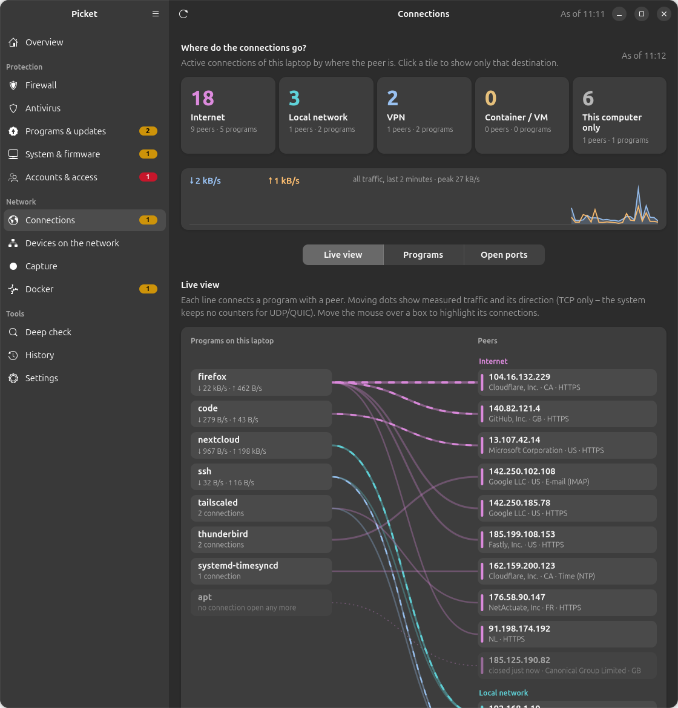
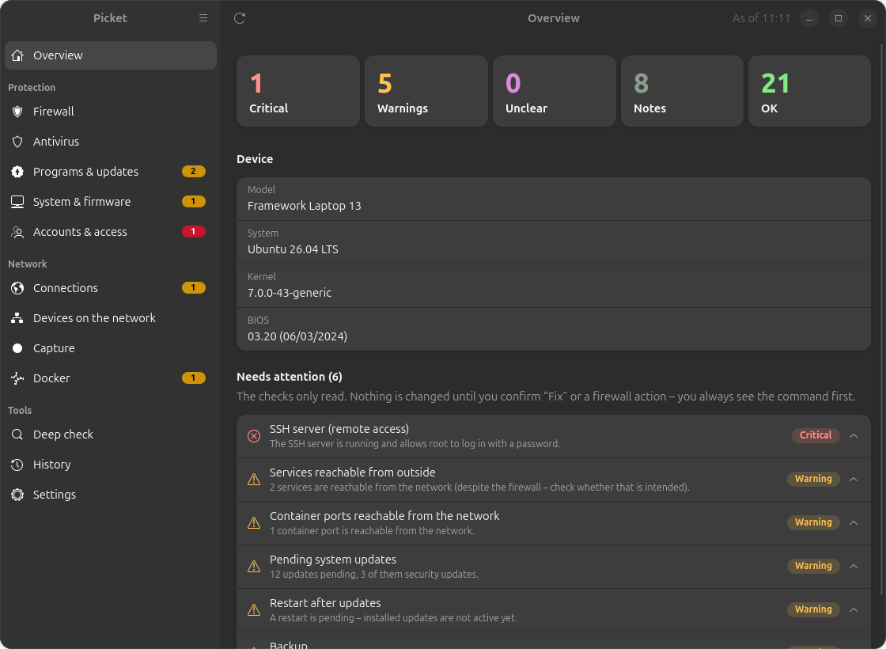
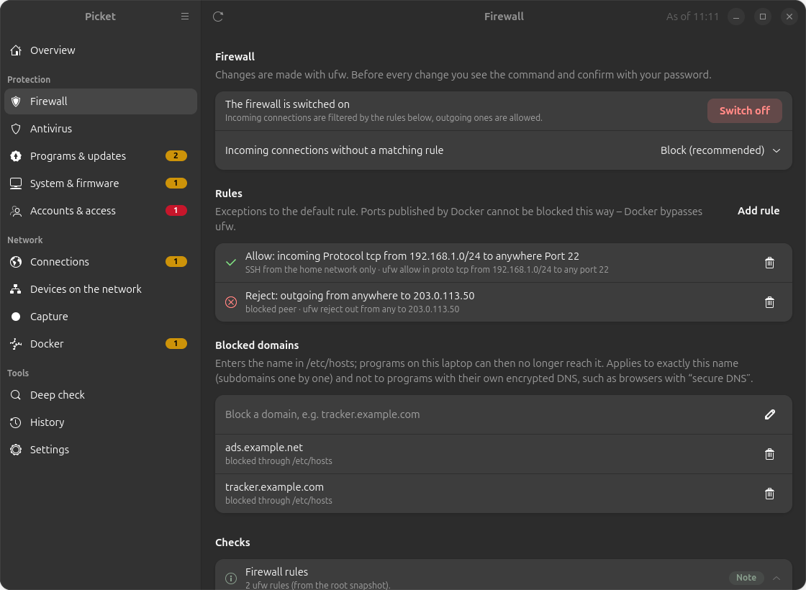
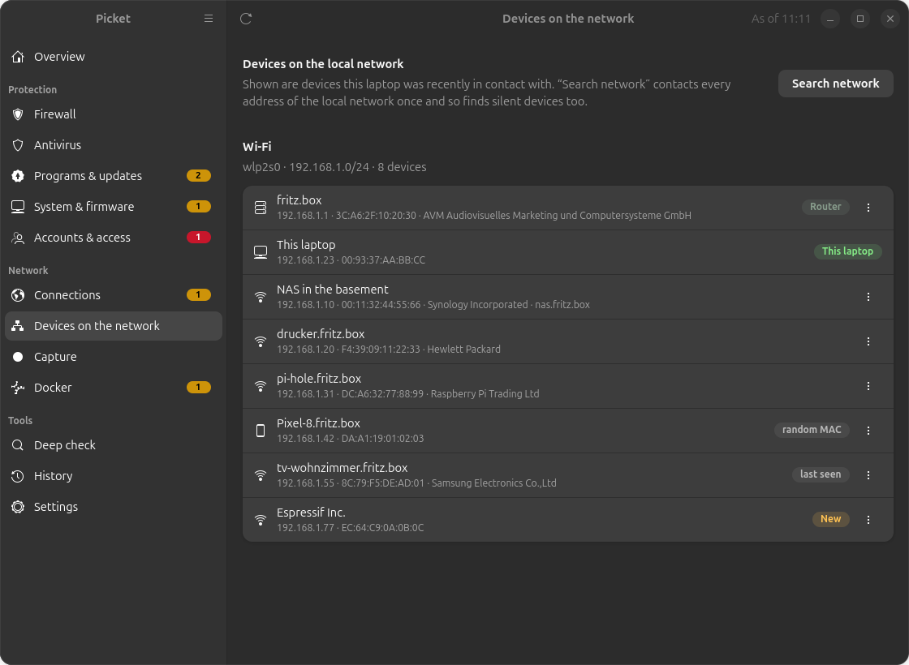
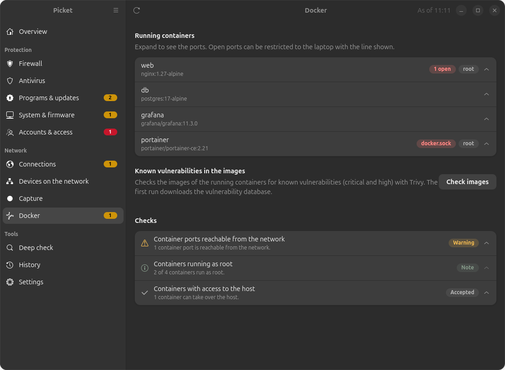

<p align="center">
  
</p>

<h1 align="center">Picket</h1>

<p align="center">
  A security check-up for your Linux laptop.<br>
  Firewall, live connections, devices on the network, updates and system hardening in one native app.
</p>



A *picket* is a forward guard post, and a stake in a fence. Picket stands watch over one machine: it tells
you what is exposed, what is out of date and who your laptop is talking to, explains each finding in plain
language, and lets you fix the common problems on the spot.

It is a single Rust binary with a GTK4/libadwaita window, a terminal interface and a small local browser
dashboard.

The interface follows the system language: German on a German system, English everywhere else.

## What it does

- **Checks the machine.** Firewall state and rules, services reachable from the network, Docker containers,
  antivirus, pending updates, disk encryption, Secure Boot, firmware, kernel hardening, accounts, SSH, backups.
  Every finding says what was found, why it matters and what to do.
- **Shows where connections go.** A live diagram links each program to the servers it talks to, grouped into
  Internet, local network, VPN and containers, with country and operator. Connections that have closed stay
  visible for a while instead of vanishing.
- **Lists the devices on your network** with address, manufacturer and name, and can probe a device for
  common services.
- **Records packets.** A capture through `tcpdump` is decoded into readable lines (DNS names, TLS server
  names, plain HTTP) and can be saved as `.pcap` for Wireshark.
- **Lets you act.** Switch the firewall on, add and delete rules, block a host or a domain, close a
  connection, restrict a Docker port to the laptop, apply one-click fixes. You always see the exact command
  first.
- **Keeps watch in the background.** An optional watcher sends a desktop notification when something
  changes: a new open port, a new device, a program that goes online for the first time, a new warning.
- **Digs deeper on request.** Secrets in plain-text files, autostart entries, set-uid files, modified system
  binaries, a Lynis audit, known vulnerabilities in container images (Trivy) and in cargo/pip/npm packages.

## Screenshots

| | |
|---|---|
|  |  |
| The overview: what needs attention | Firewall: state, rules and blocked domains |
|  |  |
| Devices on the local network | Containers, their ports and privileges |

All screenshots show made-up sample data (`PICKET_DEMO=1`). More in the [user guide](docs/user-guide.md).

## Requirements

Picket is developed and tested on **Ubuntu 26.04 with GNOME**. It relies on Ubuntu's tools (`apt`, `ufw`),
so other distributions are untested and some checks will not apply there.

To build you need a Rust toolchain (1.80 or newer; developed with 1.98, for example from
[rustup](https://rustup.rs)) and the GTK development packages:

```sh
sudo apt install libgtk-4-dev libadwaita-1-dev
```

GTK 4.12 and libadwaita 1.5 or newer are needed. Each of the following is optional and enables one part:

| Tool | Used for |
|---|---|
| `ufw` | firewall state, rules, blocking |
| `tcpdump` | packet capture |
| `clamav` | virus scan |
| `docker` | container page |
| `trivy` | vulnerabilities in container images |
| `lynis` | system audit in the deep check |
| `fwupd`, `mokutil` | firmware and Secure Boot checks |
| `libnotify-bin` | notifications from the watcher |

## Install

```sh
git clone https://github.com/blanpa/picket.git
cd picket
cargo install --path .          # installs ~/.cargo/bin/picket
picket install-desktop          # adds Picket to the application menu
sudo ~/.cargo/bin/picket install-helper   # once: root helper for firewall, capture and system data
```

The last step is optional; the window offers it the first time it is needed. See
[the security model](docs/security-model.md) for what the helper is and why it exists.

To build without the window (terminal and browser dashboard only, no GTK needed):

```sh
cargo build --release --no-default-features
```

## Usage

Start **Picket** from the application menu, or run `picket`.

Everything is also available in the terminal:

| Command | What it does |
|---|---|
| `picket check` | Report in the terminal (`--all` for every detail, `--json` for scripts). Exit code 1 if anything is critical. |
| `picket net` | Where connections go and which ports are reachable |
| `picket devices [--scan]` | Devices on the local network; `--scan` probes every address once |
| `picket ports <IP>` | Try the usual service ports of one device |
| `picket docker` / `picket images` | Containers and their ports / known vulnerabilities in their images |
| `picket scan <path>` | Virus scan with ClamAV |
| `picket deep` | The deep check (takes a few minutes) |
| `picket watch [on\|off]` | One watcher round / run it every five minutes in the background |
| `picket events`, `picket history [day]` | What the watcher reported / connections per day |
| `picket fix <finding> [--dry-run]` | Apply the fix that belongs to a finding |
| `picket accept <finding>` | Accept a finding: it stops counting until it changes |
| `picket report` | The report as a standalone HTML page |
| `picket update-data` | Download the country database and the domain blocklist |
| `picket serve` | The browser dashboard on `127.0.0.1` |

Run `picket help` for the full list. `PICKET_LANG=de` or `PICKET_LANG=en` overrides the language.

## How it treats your system

- **Checks only read.** Nothing changes until you confirm an action, and every confirmation shows the command.
- **Root actions go through a separate helper**, a root-owned copy of the binary with its own polkit rule.
  It accepts four commands and validates their arguments; no free-form text reaches `ufw` or `tcpdump`.
- **Nothing is sent anywhere by default.** Downloads (country database, blocklist) and look-ups
  (osv.dev, Trivy) happen only when you ask for them.
- **System tools are started from fixed system directories**, never through `$PATH`.

The details, including a list of every file Picket writes, are in [docs/security-model.md](docs/security-model.md).

## Limitations

- The connection view looks every 5 seconds. Connections shorter than that are missed; only a capture is complete.
- Per-connection traffic is measured for TCP only. The throughput chart covers everything, including QUIC.
- Traffic from inside containers and virtual machines is not attributed to a program.
- The firewall verdict for a port understands `ufw` rules. Docker is accounted for; rules added by other
  tools (libvirt, Multipass) are not.
- Blocking a host blocks one IP address; blocking a domain blocks exactly that name through `/etc/hosts`
  and does not affect programs that use their own encrypted DNS.
- Vulnerability look-ups cover container images and cargo/pip/npm packages, not manually installed `.deb` files.
- The browser dashboard only has the checks and the connection list, not the newer pages.

## Documentation

- [User guide](docs/user-guide.md): a tour of every page
- [Security model](docs/security-model.md): what runs as root, what leaves the machine, what is stored
- [Development](docs/development.md): layout of the code, tests, demo mode, regenerating the screenshots

## License

Copyright © 2026 blanpa

Picket is free software: you can redistribute it and/or modify it under the terms of the
[GNU General Public License](LICENSE) as published by the Free Software Foundation, either version 3 of
the License, or (at your option) any later version.

It is distributed in the hope that it will be useful, but **without any warranty**; without even the implied
warranty of merchantability or fitness for a particular purpose. See the license for the details.
