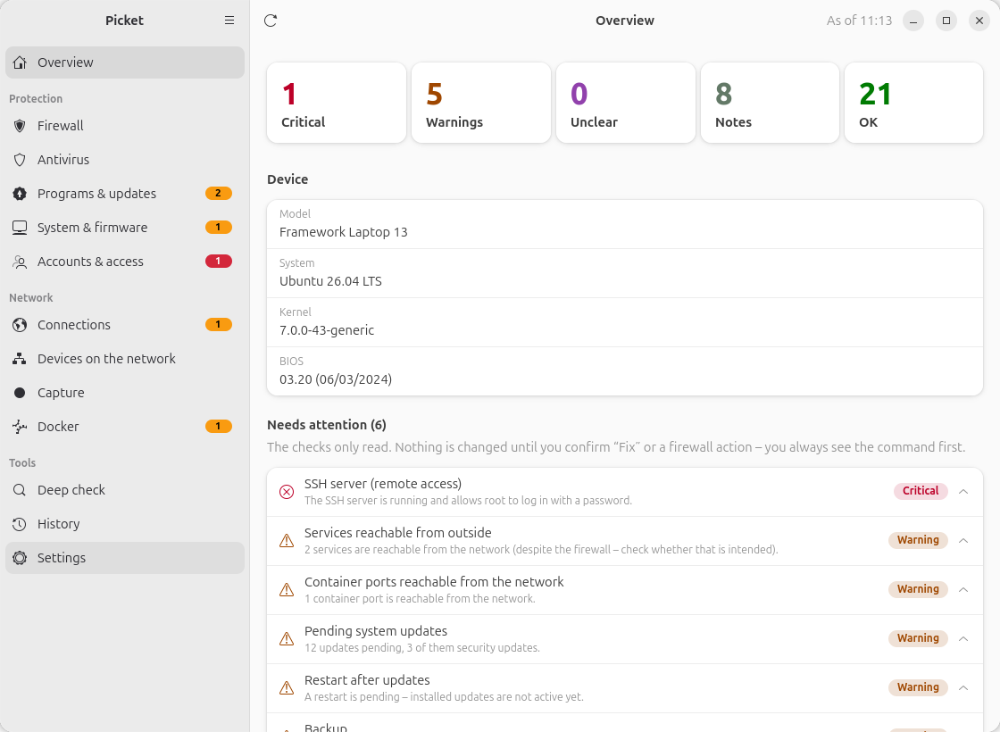
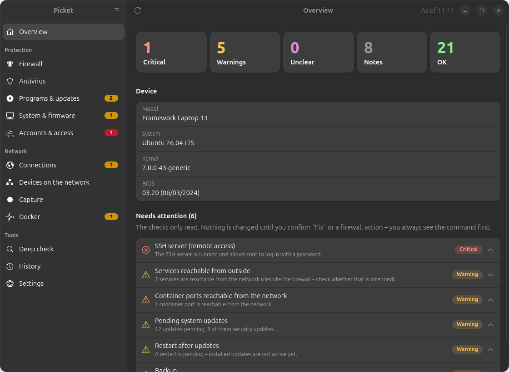
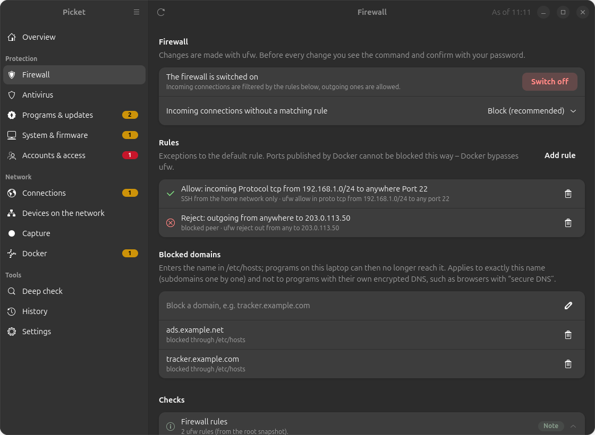
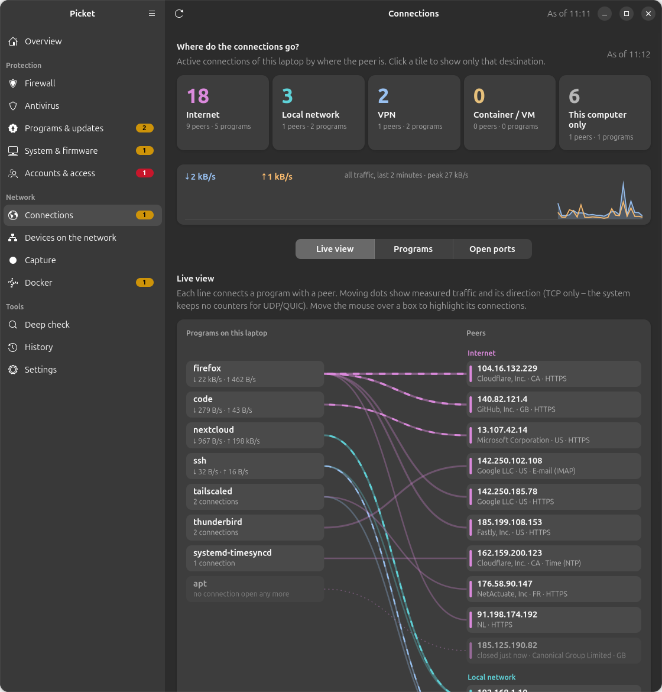
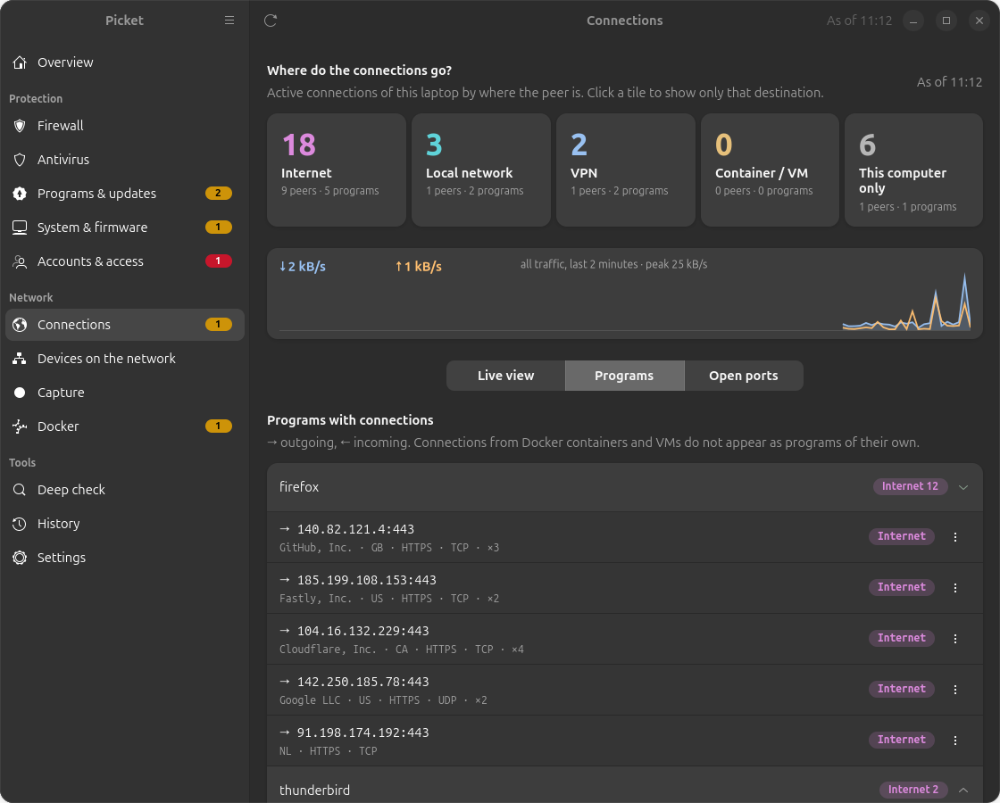
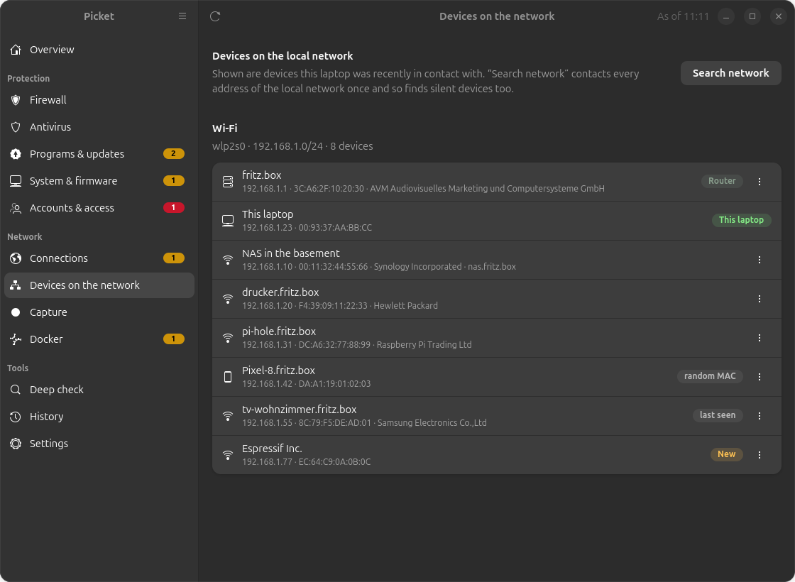
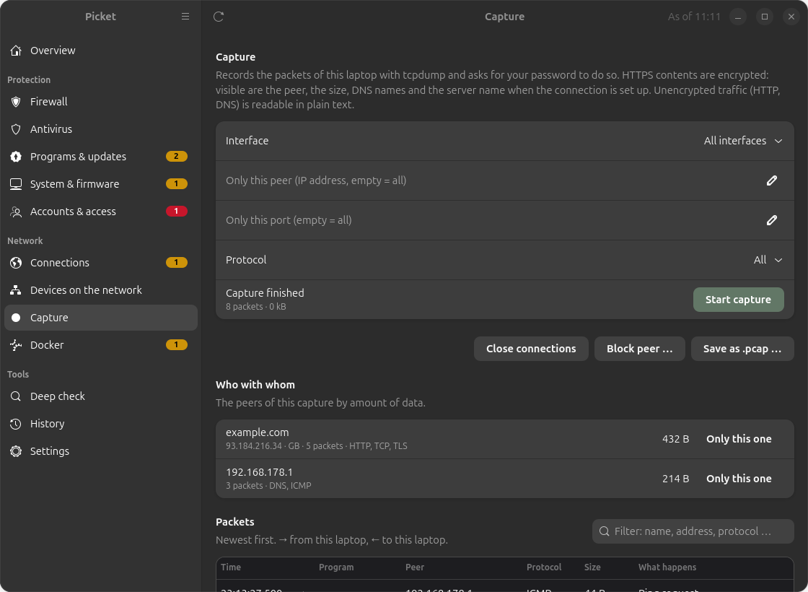
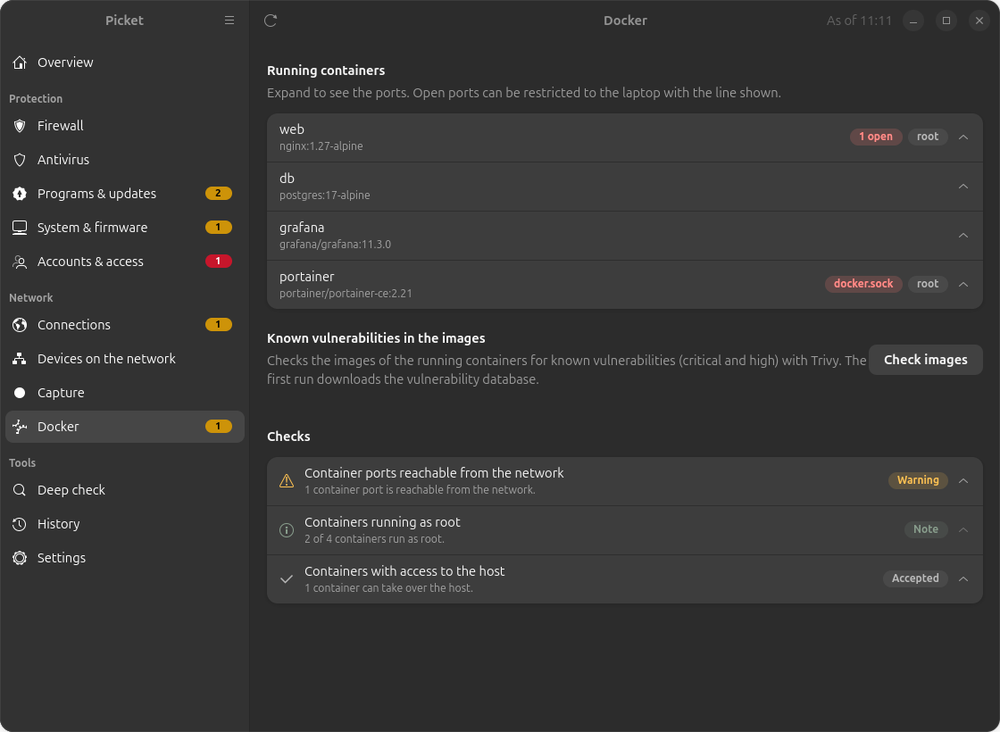
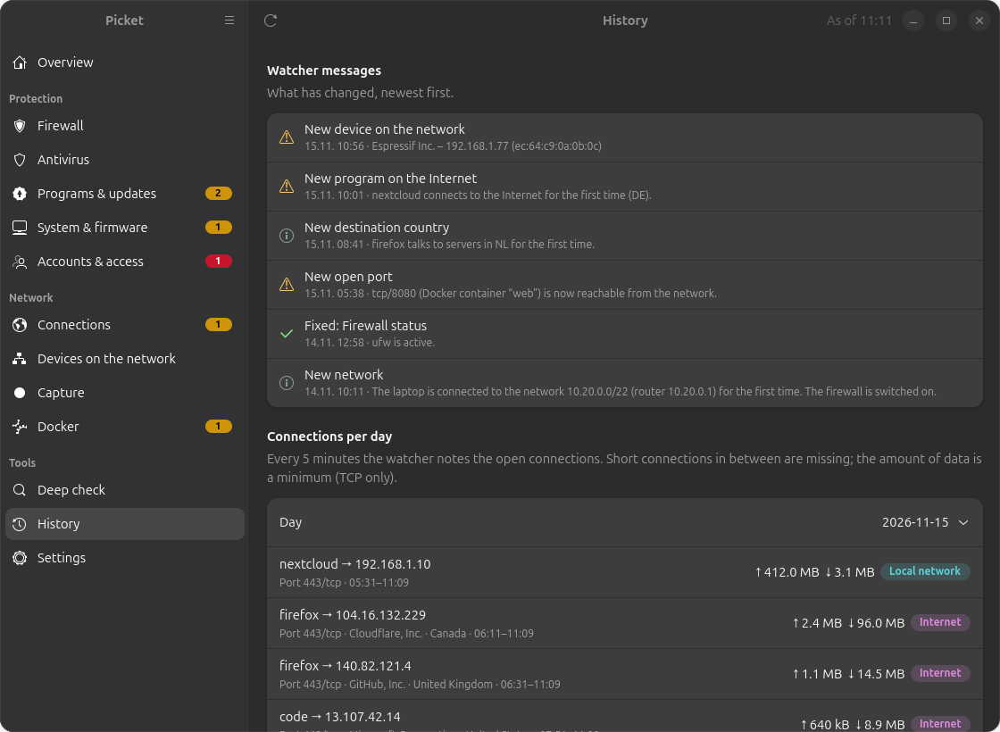

# User guide

A tour of the window, page by page. The interface follows the system language: German on a German system,
English everywhere else. This guide uses the English labels. All screenshots show sample data from demo mode.

The sidebar has three sections: **Protection**, **Network** and **Tools**.
A number next to a page counts its critical findings (red) or warnings (yellow). The menu at the top of the
sidebar has *check again* (`Ctrl+R`), *save report* (`Ctrl+S`) and *settings* (`Ctrl+,`).

Picket follows the desktop's light or dark style:

## Overview

The five tiles count the findings by severity: **Critical**, **Warnings**, **Unclear** (could not be
checked), **Notes** and **OK**. Below them, **Needs attention** lists everything critical or worth a warning.

### Findings

Every finding is a row you can open. Inside you find:

- why it matters,
- what was actually found on this machine,
- a recommendation, with commands you can copy,
- **Fix …**, when Picket can apply the remedy itself. You see the commands before anything runs.
- **Accept**, for decisions you have made consciously. An accepted finding no longer counts
  or triggers notifications. If the finding changes, for example a fourth open port appears where you
  accepted three, it comes back.

A banner at the top appears when some checks need root data (firewall rules, the names of other users'
processes, the password check). **Unlock** collects it through the system's password dialog; the
data is kept for 24 hours.

## Protection

### Firewall

- Switch `ufw` on or off, and choose what happens to incoming connections that match no rule.
- **Add rule** opens a form for a rule: allow, block, reject or rate-limit; incoming or outgoing;
  port, protocol, address. The resulting `ufw` command is shown as you type.
- Blocking rules are placed first, so that an older *allow* rule cannot override them.
- **Blocked domains** blocks a host name for all programs on the laptop through an entry in `/etc/hosts`.

Every change shows the command and asks for your password. The existing rules can only be read with root
data; until then the list says so.

### Antivirus

Checks that ClamAV is installed, that its signatures are current and that the update service runs. A scan
of the download folder, the home directory or `/tmp` can be started and cancelled here. Picket never deletes
anything it finds.

### Programs & updates

Pending `apt` updates and how many of them are security updates, updates only available through Ubuntu Pro,
snaps, Flatpaks, firmware, a pending restart, packages that have no update source, and third-party
package sources.

### System & firmware

Disk encryption (LUKS), swap, Secure Boot, the firmware security level reported by `fwupd` (HSI), AppArmor,
CPU vulnerabilities, kernel hardening settings and whether a backup has run recently.

### Accounts & access

User accounts, who has administrator rights, the SSH server, permissions in `~/.ssh`, SSH keys without a
passphrase, automatic login and the screen lock.

## Network

### Connections

The five tiles count the open connections by where the other side is: Internet, local network, VPN,
container/VM and the laptop itself. **Click a tile** to show only that destination.

The chart shows the total throughput of the last two minutes, taken from the kernel's interface counters.
It includes everything, also UDP and QUIC.

Three tabs show the same data in different ways:

**Live view.** Programs on the left, remote hosts on the right, one line per pair. Moving dashes
mean measured traffic, and they move in the direction the data flows. Hover over a box to highlight its
connections. Click a **program** to open its list of connections; click a **host** to record its traffic,
close the connection or block it. A dotted line and a faded box mean the connection has closed.

**Programs.**

Each program with its connections. `→` is outgoing, `←` incoming. The `⋮` menu on a connection offers
*Capture*, *Close connection* and *Block peer*. Closed connections stay in the list, faded and marked
*closed*.

**Open ports.** Services waiting for incoming connections and from where they can be
reached. When the firewall is on and its rules are readable, a port the firewall closes is marked
*Blocked by the firewall*. Ports published by Docker stay marked as open: Docker bypasses `ufw`.

How long closed connections stay visible is set under *Settings*: not at all, 5 minutes, 30 minutes
(the default) or until the app is closed.

### Devices on the network

The devices this laptop has recently exchanged packets with, per network: address, hardware address,
manufacturer and name. **Search network** sends one small packet to every address of the subnet, which
also finds devices that have been silent.

The `⋮` menu lets you give a device a name of your own and check which common services answer on it.
Unencrypted or typically unprotected services are flagged.

A device is marked **New** when it appears after you have searched the network once.

### Capture

Records the laptop's packets with `tcpdump`, optionally limited to one remote address, port or protocol.
The list shows time, direction, program, remote side, protocol, size and a description: the name asked for
in a DNS query, the server name in a TLS handshake, the first line of an unencrypted HTTP request.

- **Who with whom** sums up the remote sides by data volume; *Only this one* narrows the list to one of them.
- The search field filters by name, address or protocol.
- **Save as .pcap** saves the raw capture, for example to open it in Wireshark.

The content of HTTPS connections is encrypted and stays unreadable. A capture stops when you stop it, when
you close the window, after 15 minutes or after 200,000 packets.

### Docker

Running containers with their images, ports and privileges. For a port that is open to the network,
**Restrict …** rewrites the line in the compose file so the port binds to `127.0.0.1`, shows the change
first, keeps a backup of the file and recreates the container.

**Check images** asks Trivy for known vulnerabilities (critical and high) in the images of the running
containers.

## Tools

### Deep check

Slower inspections, run on request:

- access keys and passwords in plain-text files in your home directory (only the path and the kind are
  reported, never the secret),
- programs that start by themselves,
- set-uid files that belong to no package,
- system programs whose checksum no longer matches their package,
- a Lynis audit without root rights.

**Look up known vulnerabilities online** asks osv.dev about packages installed with cargo, pip or npm. The
list of names and versions is shown before it is sent.

### History

What the watcher has reported, and per day which program talked to whom, with data volume, country and
operator. Recording only happens while the watcher is on.

### Settings

- **Watcher in the background**: see below.
- The country database and the domain blocklist: download or refresh them.
- **Save report**: all findings as an HTML page.
- Options for the connections page.

## The watcher

Switched on in the settings (or with `picket watch on`), a systemd user timer runs a check every five
minutes. It compares the result with the previous round and sends a desktop notification when:

- a finding becomes critical or a warning,
- a port becomes reachable from the network,
- a new device appears on a network you have searched before,
- a program connects to the Internet for the first time,
- the laptop joins a network it has never been on while the firewall is off.

A program reaching a new country, or a new network with the firewall on, is noted in the history without a
notification. The first round only records the starting point.
